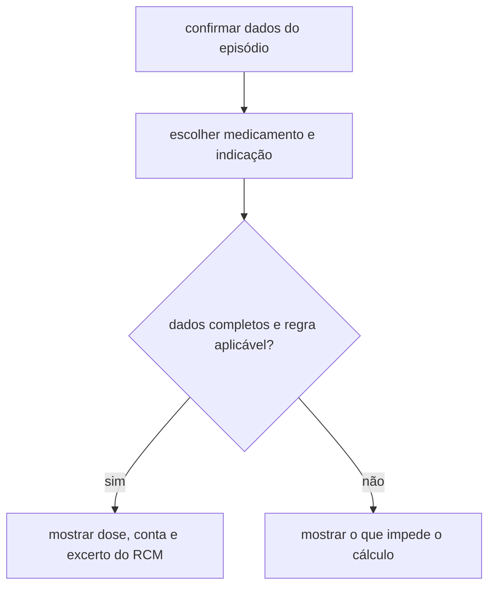

# Apoio à prescrição pediátrica

ideia: médico consiga ver a dose calculada, perceber de onde veio e conferir a regra no RCM.

## o ecrã

| Dados do caso | Resultado para rever |
| --- | --- |
| **Episódio** · idade e peso | **Dose por administração** e frequência |
| **Medicamento** · indicação, via e apresentação | **Como foi calculada** · dados usados, conta e limite, se aplicado |
| **Dados adicionais** · só os pedidos pela regra | **Fonte** · excerto e versão do RCM |

 o esboço em streamlit para ver o fluxo e pegamos num dos medicamentos que já foram separados. escolhemos uma indicação e uma apresentação, revemos a regra com a equipa clínica e preparamos três casos fictícios.

- [ ] **caso completo** — a dose e a frequência batem certo com o resultado esperado.
- [ ] **falta um dado** — o ecrã diz qual é o campo em falta e suspende o cálculo.
- [ ] **caso fora da regra** — o ecrã explica porque é que aquele caso fica sem resultado.

regra definir um limite de dose, acrescentamos um caso que chegue a esse limite.

separar o cálculo da interface. A app web em React envia o caso à API em python, que aplica a regra validada e devolve o resultado. Para o primeiro teste, os dados do episódio vêm de uma simulação.
